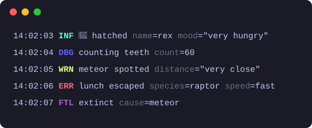

# logosaur 🦖

[](https://www.npmjs.com/package/logosaur)
[](https://github.com/0c71/logosaur/actions/workflows/ci.yml)


A tiny, colorful, structured logger for Bun and TypeScript.
Short Go-style levels, `key=value` fields and zero dependencies. Rawr.



## Install

```bash
bun add logosaur
```

It works in Node too: `npm install logosaur`.

## Usage

```ts
import { log } from "logosaur";

log.info("🦖 hatched", { name: "rex", mood: "very hungry" });
log.warn("meteor spotted", { distance: "very close" });
log.error("lunch escaped", { species: "raptor", speed: "fast" });
```

```
14:02:03 INF 🦖 hatched name=rex mood="very hungry"
14:02:05 WRN meteor spotted distance="very close"
14:02:06 ERR lunch escaped species=raptor speed=fast
```

## Levels

Three letters each, like Go's loggers.

| Method      | Label | Notes                                       |
| ----------- | ----- | ------------------------------------------- |
| `log.debug` | `DBG` | hidden unless the level is `debug`          |
| `log.info`  | `INF` | the default level                           |
| `log.warn`  | `WRN` |                                             |
| `log.error` | `ERR` |                                             |
| `log.fatal` | `FTL` | logs, then goes extinct (exits with code 1) 🦴 |

```ts
log.setLevel("debug");
```

## Fields

Nested objects are flattened, empty values are skipped, and strings with
spaces get quotes.

```ts
log.info("dinner served", {
  pen: { id: 7, fence: "electric" },
  guests: ["rex", "blue"],
  note: null,
});
```

```
14:02:03 INF dinner served pen.id=7 pen.fence=electric guests=[rex blue]
```

Errors log as their message, and dates as ISO strings.

## Hatchlings

Sub-loggers that carry fields or a prefix on every line:

```ts
const pen = log.with({ pen: 7 });
pen.warn("fence flickering");
// 14:02:03 WRN fence flickering pen=7

const cave = log.withPrefix("cave");
cave.info("echo");
// 14:02:03 INF cave: echo
```

## Options

```ts
import { createLogger } from "logosaur";

const log = createLogger({
  level: "debug",
  prefix: "park",
  timeZone: "America/New_York",
  file: (day) => `logs/${day}.log`,
});
```

| Option     | Default          | What it does                                            |
| ---------- | ---------------- | ------------------------------------------------------- |
| `level`    | `"info"`         | The quietest level that gets through                    |
| `prefix`   |                  | Shown before every message, as `prefix:`                |
| `fields`   | `{}`             | Fields added to every line                              |
| `time`     | `true`           | Show the time on text lines                             |
| `timeZone` | local            | Any IANA time zone, like `"Europe/London"`              |
| `format`   | `"text"`         | `"text"`, `"json"` or `"logfmt"`                        |
| `color`    | auto             | Force colors on or off                                  |
| `output`   | `process.stderr` | Anything with a `write(text)` method                    |
| `file`     |                  | Also append plain lines to a file, or one file per day  |
| `replacer` |                  | `(key, value) => value`, to reshape fields at any depth |

## Formats

```ts
createLogger({ format: "json" }).info("hatched", { egg: { size: "large" } });
// {"time":"2026-11-17T19:02:03.000Z","level":"info","msg":"hatched","egg":{"size":"large"}}

createLogger({ format: "logfmt" }).info("hatched", { name: "rex" });
// time=2026-11-17T19:02:03.000Z level=info msg=hatched name=rex
```

## Colors

Colors turn on by themselves in a terminal. `NO_COLOR` turns them off,
`FORCE_COLOR` turns them on, or pass `color: true` or `false`. Files never get
colors.

## License

[MIT](LICENSE)

---

Made with 🦴 and a very small brain. Rawr.
